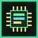
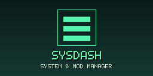
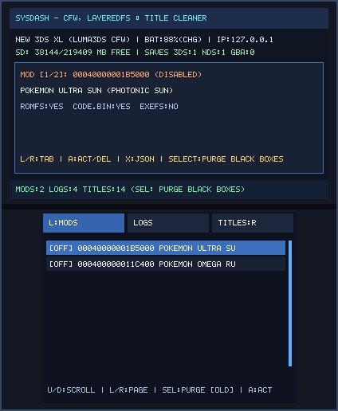
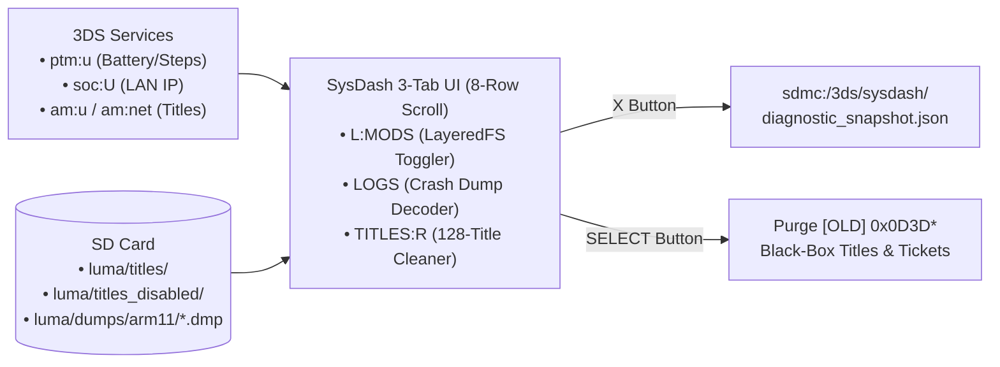

# SysDash (`3ds_sysdash`)

<p align="center">
  
  &nbsp;&nbsp;&nbsp;
  
</p>

<p align="center">
  
</p>

> **System & Mod Manager (`CTR-P-SYSD`, UniqueId `0x0D3E2`)** — Part of the [**lafiabrew**](https://github.com/orgs/lafiabrew/repositories) Nintendo 3DS Homebrew Suite (companion hub: [`lafiabrew/3ds_hub`](https://github.com/lafiabrew/3ds_hub)).

Nintendo 3DS CFW hardware/battery/IP inspector, 1-button Luma3DS LayeredFS ROM-hack mod toggler, crash dump analyzer, and 128-title scrollable manager with 1-button black-box title purging.

---

## Architecture & Data Flow



---

## Controls & Touch Ergonomics (Old 3DS · 2DS · New 3DS XL)

| Button / Input | Action |
|---|---|
| `L` / `R` (or Touch Tabs) | Switch between **`L:MODS`** (LayeredFS), **`LOGS`** (Crash Dumps), and **`TITLES:R`** (Installed SD Titles) |
| `D-Pad Up / Down` | Scroll 1 row up/down through the 8-row sliding viewport (with proportional scrollbar) |
| `D-Pad Left / Right` | Page Jump **8 rows** up/down (fast navigation through 100+ installed titles) |
| `A` (or Double-Tap Row) | Toggle selected Luma3DS LayeredFS mod (`ON`/`OFF`) or delete selected `[OLD]`/`[APP]` SD title + ticket |
| `SELECT` | **1-Button Black-Box Purge**: Deletes all legacy `0x0D3D0..0x0D3DF` test titles, tickets, and pending imports |
| `X` | Export full JSON diagnostic snapshot (`sdmc:/3ds/sysdash/diagnostic_snapshot.json`) |
| `Y` | Rescan SD card mods, logs, and installed titles |
| `START` | Exit to HOME Menu / Homebrew Launcher |

---

## SD Card Paths & Telemetry Logs

- `sdmc:/luma/titles/<TitleID>/` ↔ `sdmc:/luma/titles_disabled/<TitleID>/` — Atomic LayeredFS ROM-hack toggling
- `sdmc:/luma/errdisp.txt` & `sdmc:/luma/dumps/arm11/*.dmp` — Decoded ARM11/ARM9 exception headers
- `sdmc:/3ds/sysdash/diagnostic_snapshot.json` — Exported system + mod + crash log snapshot
- `sdmc:/3ds/logs/sysdash.log` — Structured UTC operational log

---

## Build, Verify & Install

```bash
# 1. Run host C11 ASan/UBSan pass-the-pass & fail-the-fail unit + UI tests
make test

# 2. Build optimized ARM11 (-Os -flto + stripped ELF) .elf, .smdh, .3dsx, and .cia
make 3ds && make verify-3ds

# 3. Serve FBI QR code or push .cia over LAN via serve_3ds.py
make qr
```
